# Olá, sejam bem-vindos ao meu GitHub! 👋

### Fullstack Software Engineer | Java (Spring Boot) & JavaScript/TypeScript (React, Next.js)

---

## 👨‍💻 Sobre Mim

Desenvolvedor de Software Fullstack com foco na construção de aplicações web utilizando **Java e Spring Boot** no back-end e **JavaScript, TypeScript, React e Next.js** no front-end.

Tenho experiência prática no desenvolvimento de APIs REST, autenticação e autorização, integração com bancos de dados relacionais e NoSQL e criação de interfaces modernas e responsivas. Também aplico boas práticas de organização de código, componentização, arquitetura em camadas e separação de responsabilidades.

Gosto de transformar necessidades reais em soluções funcionais, mantendo atenção à qualidade, manutenibilidade e experiência de uso.

---

## 🕹️ Meu Ecossistema de Contribuições

Aqui você pode acompanhar meus commits sendo devorados pelo Pacman em tempo real!

<picture>
  <source media="(prefers-color-scheme: dark)" srcset="https://raw.githubusercontent.com/moronioliveira/moronioliveira/output/pacman-contribution-graph-dark.svg">
  
</picture>

---

## 🛠️ Tecnologias & Hard Skills

| Categoria | Tecnologias |
| :--- | :--- |
| **Linguagens** |      |
| **Front-end** |     |
| **Back-end** |     |
| **Bancos de Dados** |   |
| **ORM & Persistência** |   |
| **Autenticação & Serviços** |   |
| **Testes & Qualidade** |    |
| **Ferramentas** |       |

---

## 🚀 Projetos em Destaque

### 💰 [FinTrack](https://github.com/moronioliveira/fintrack)

Aplicação de gestão financeira pessoal que centraliza receitas, despesas e compromissos em um dashboard para facilitar o acompanhamento e o planejamento financeiro.

- **Funcionalidades:** Dashboard com saldo, receitas, despesas e fluxo de caixa; cadastro, edição, exclusão, busca e filtros de transações; categorias personalizáveis; contas recorrentes; metas financeiras; orçamentos mensais por categoria.
- **Destaques técnicos:** Modelagem de domínio com TypeScript, gerenciamento de estado compartilhado com Context API, autenticação baseada em sessão e persistência de dados por usuário.
- **Tech Stack:** Next.js 16, React 19, TypeScript, Tailwind CSS 4, PostgreSQL, Prisma e Lucide React.
- 🔗 [Acessar aplicação online](https://fintrack-three-lovat.vercel.app/)

### 💻 [Solid Solutions](https://github.com/moronioliveira/solidSolutions)

Website institucional e portfólio da Solid Solutions, criado para apresentar serviços de desenvolvimento de sites e landing pages, projetos e opções comerciais.

- **Funcionalidades:** Apresentação de serviços e projetos, seções de planos e preços, navegação responsiva e contato comercial por links do WhatsApp com mensagens pré-preenchidas.
- **Destaques técnicos:** Componentização, organização de estilos e componentes reutilizáveis, metadados, Open Graph, JSON-LD, sitemap e configuração de SEO.
- **Tech Stack:** Next.js 15, React 19, TypeScript, Tailwind CSS 4, Radix UI, React Hook Form e Zod.
- **Testes:** Vitest e Testing Library.
- 🔗 [Acessar aplicação online](https://solid-solutions-portifolio.vercel.app/)

### 📄 [AtaNext — Atas+](https://github.com/moronioliveira/atanext)

Aplicação web para organizar o planejamento de reuniões dominicais por ala e gerar uma visualização pronta para impressão.

- **Funcionalidades:** Planejamento mensal dividido por domingos, edição da programação e participantes, sugestões com autocomplete, acompanhamento do progresso, pré-visualização para impressão e salvamento dos planejamentos.
- **Gestão de acesso:** Cadastro da ala, papéis de líder e administrador, gerenciamento de pessoas e convites para novos administradores.
- **Destaques técnicos:** Rotas de API, autenticação, controle de acesso por papel e persistência de dados com PostgreSQL.
- **Tech Stack:** Next.js 16, React 19, TypeScript, Neon PostgreSQL e Neon Auth.
- 🔗 [Acessar aplicação online](https://atanext.vercel.app/)

### ⚙️ [Task Scheduler BFF](https://github.com/moronioliveira/bff-agendador-tarefas)

Sistema back-end com arquitetura distribuída em microsserviços e camada BFF (Backend For Frontend), desenvolvido para centralizar o acesso a serviços de usuários, agendamento de tarefas e notificações.

- **Serviços:** Gerenciamento de usuários e autenticação, criação e controle de tarefas agendadas e disparo automatizado de notificações.
- **Destaques técnicos:** Autenticação stateless com Spring Security e JWT, tratamento global de exceções, arquitetura em camadas, integração com bancos SQL e NoSQL e documentação interativa da API.
- **Tech Stack:** Java 21, Spring Boot, Spring Security, Spring Data JPA, Hibernate, PostgreSQL, MongoDB, Swagger/OpenAPI e Lombok.

---

## 📈 Estatísticas e Performance

---

## 📫 Conecte-se comigo

---

⭐ Obrigado pela visita! Fique à vontade para explorar meus projetos e acompanhar minha evolução como desenvolvedor.
